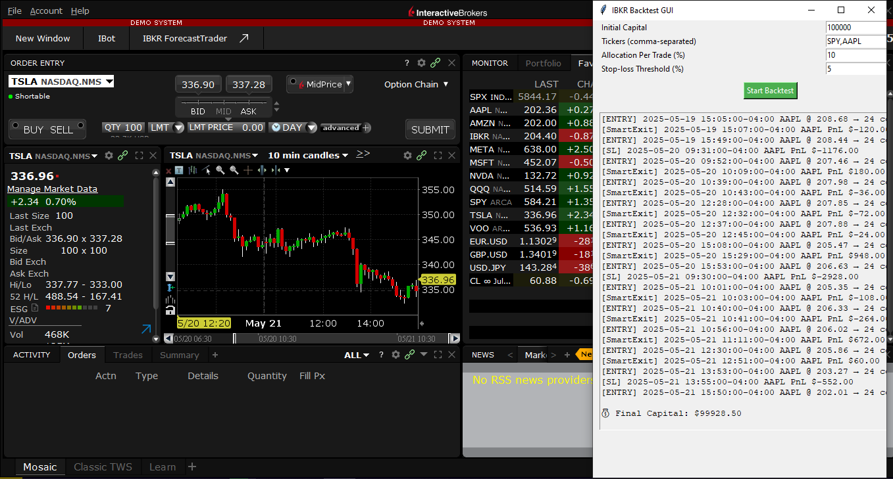
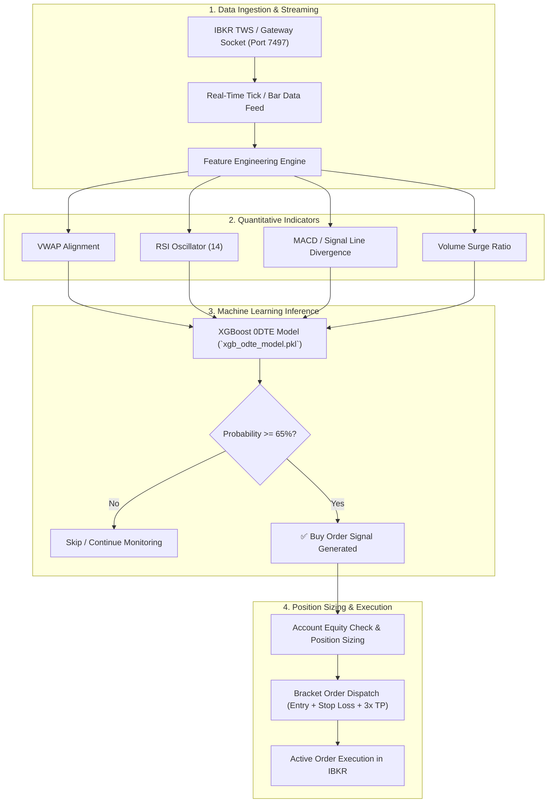

# 📈 Interactive Brokers (IBKR) AI 0DTE Options Trading Bot & GUI

[](https://python.org)
[](https://interactivebrokers.com)
[](https://xgboost.readthedocs.io)
[](https://docs.python.org/3/library/tkinter.html)
[](https://opensource.org/licenses/MIT)

> An algorithmic options and equity trading desktop terminal built for **Interactive Brokers (IBKR)**. Powered by a trained **XGBoost machine learning classifier** for short-term price momentum prediction, multi-indicator entry filters (VWAP, RSI, MACD), dynamic risk-managed position sizing, and a **3-tier profit-taking ladder**.

<p align="center">
  
</p>

---

### 💼 Need Custom IBKR Algorithms, Options Bots, or Institutional Quant Systems?
I engineer high-performance trading software, broker API integrations, and machine learning models for hedge funds, prop traders, and private syndicates.
* 💬 **Telegram:** [@JanzebBlockdev](https://t.me/JanzebBlockdev)
* 💼 **Fiverr Profile:** [Verified Quantitative Developer (Fiverr)](https://tinyurl.com/2wruxnsx)
* 📧 **Email:** `jahanzaibchanna70@gmail.com`

---

## 📑 Table of Contents
1. [Key Architectural Highlights](#-key-architectural-highlights)
2. [End-to-End Decision & Execution Pipeline](#-end-to-end-decision--execution-pipeline)
3. [Machine Learning & Quantitative Entry Filters](#-machine-learning--quantitative-entry-filters)
4. [Risk Management & Tiered Profit Scaling](#-risk-management--tiered-profit-scaling)
5. [Prerequisites & TWS / IB Gateway Configuration](#-prerequisites--tws--ib-gateway-configuration)
6. [Installation & Quickstart](#-installation--quickstart)
7. [Backtesting Engine](#-backtesting-engine)
8. [Explore Other Quantitative Projects](#-explore-other-quantitative-projects)
9. [Disclaimer](#-disclaimer)

---

## 🚀 Key Architectural Highlights

* **High-Speed IBKR Connectivity:** Integrates seamlessly via `ib_insync` with Interactive Brokers Trader Workstation (TWS) or IB Gateway over socket port `7497` (Paper) or `7496` (Live).
* **Pre-Trained XGBoost Predictive Engine:** Includes `xgb_odte_model.pkl` trained to detect short-duration trend continuation setups on high-volume tickers (SPY, QQQ, AAPL, NVDA).
* **Asynchronous Multi-Threaded GUI:** Built with Tkinter to ensure zero GUI freezing during heavy historical backtest calculations or live market data streaming.
* **Tiered Profit Scaling:** Automates scaling out of winning contracts at `+25%`, `+75%`, and `+150%`, while trailing the remaining runner.
* **Comprehensive Trade Logging:** Automatically exports timestamped executions, slippage metrics, and P&L results to `milestone2_trade_log.csv`.

---

## 🏛️ End-to-End Decision & Execution Pipeline



---

## 🧠 Machine Learning & Quantitative Entry Filters

The predictive engine requires unanimous alignment between machine learning probabilities and quantitative filters before dispatching order brackets:

1. **XGBoost Classifier (`xgb_odte_model.pkl`):** Trained on historical 1-minute and 5-minute OHLCV bars across major index equities to output real-time directional probabilities.
2. **VWAP (Volume-Weighted Average Price):** Ensures call orders trigger strictly when market price holds above VWAP, confirming institutional buying pressure.
3. **RSI Filter:** Guard against chasing overbought or oversold extremes.
4. **MACD Divergence:** Validates directional momentum alignment.

---

## 🛑 Risk Management & Tiered Profit Scaling

Capital preservation is hardcoded into every execution bracket:

| Leg Target | Percentage Gain | Quantity Scaled | Strategy |
| :--- | :--- | :--- | :--- |
| **Stop Loss** | `-20%` | `100%` | Hard stop-out if trade invalidates entry thesis |
| **Take Profit 1** | `+25%` | `33%` | Bank initial profit and move stop-loss to Breakeven |
| **Take Profit 2** | `+75%` | `33%` | Lock in major gains |
| **Take Profit 3 (Runner)** | `+150%+` | `Remaining 34%` | Trailing stop-loss captures outlier trend extensions |

---

## 🛠️ Prerequisites & TWS / IB Gateway Configuration

Before launching the bot, configure Interactive Brokers Trader Workstation (TWS):

1. Open **TWS** or **IB Gateway** and log in.
2. Navigate to **File $\rightarrow$ Global Configuration $\rightarrow$ API $\rightarrow$ Settings**.
3. Enable the following settings:
   * ✅ **Enable ActiveX and Socket Clients**
   * Socket Port: `7497` (for Paper Trading) or `7496` (for Live Trading)
   * Master API client ID: `0`
   * ✅ **Allow connections from localhost only** (or add `127.0.0.1` to Trusted IP Addresses)
4. Click **Apply** and **OK**.

---

## ⚙️ Installation & Quickstart

```bash
# 1. Clone the repository
git clone https://github.com/jahanzaib-codes/ibkr-ai-trading-bot-gui.git
cd ibkr-ai-trading-bot-gui

# 2. Create virtual environment
python -m venv venv
# Windows:
.\venv\Scripts\activate
# Linux/macOS:
source venv/bin/activate

# 3. Install dependencies
pip install -r requirements.txt

# 4. Launch the Desktop GUI
python main.py
```

---

## 🔁 Backtesting Engine

The built-in backtesting suite lets you evaluate strategy metrics without active market connections:
* Run custom backtests directly from the Tkinter GUI.
* Adjust starting capital (e.g., `$10,000`), trade allocation percentage, stop-loss threshold, and target tickers.
* Output logs and equity curve data are preserved in `gui_backtest_log.csv`.

---

## ⭐ Explore Other Quantitative Projects

* ⚡ **[Solana Pump.fun 0-Block Sniper Bot](https://github.com/jahanzaib-codes/solana-pumpfun-sniper-bot)** — Ultra low-latency meme coin sniper powered by Rust, Node.js, and Jito MEV bundles.
* 🛡️ **[PropFirm MT5 Risk Guardian EA](https://github.com/jahanzaib-codes/propfirm-mt5-risk-guardian)** — Institutional MQL5 risk manager enforcing daily and total drawdown limits for FTMO / FundedNext.
* 🔮 **[Polymarket Prediction Arbitrage Bot](https://github.com/jahanzaib-codes/polymarket-prediction-arbitrage-bot)** — Real-time binary market arbitrage engine exploiting price discrepancies across predictive books.
* 📉 **[IBKR Automated Trailing Stop Orders](https://github.com/jahanzaib-codes/ibkr-trailing-orders)** — CSV batch trailing stop limit order dispatcher with loss prevention.
* 📊 **[Real-Time NASDAQ Screener & ATR Bot](https://github.com/jahanzaib-codes/RealTime-ATR-Screener-Trader)** — Polygon.io WebSocket screener and chandelier execution engine.
* 📱 **[IBKR Telegram Bot & TradingView Webhook](https://github.com/jahanzaib-codes/ibkr-telegram-trading-bot)** — Webhook listener and remote Telegram trading terminal.

---

## ⚠️ Disclaimer

*This trading software is for educational and research purposes only. Options and derivative trading involves substantial risk of capital loss and is not suitable for every investor. Always validate strategies extensively in paper-trading mode before allocating live funds.*

---
*Maintained by **Jahanzaib** ([@jahanzaib-codes](https://github.com/jahanzaib-codes))*

